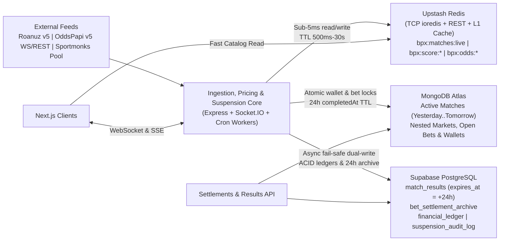
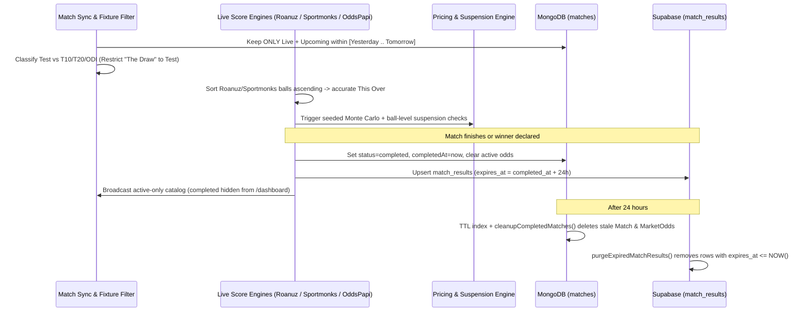

<div align="center">

# BetPro Exchange — Backend Engine & Polyglot Data Platform

**Low-Latency Sports Exchange Core, Real-Time Cricket Pricing Engine & Multi-Database Architecture**

[](https://nodejs.org/)
[](https://expressjs.com/)
[](https://www.mongodb.com/)
[](https://supabase.com/)
[](https://upstash.com/)
[](https://socket.io/)
[]()

</div>

---

## Overview

**BetPro Exchange Server** is a real-time cricket betting exchange backend engineered with **Node.js**, **Express 5**, and **Socket.IO**. It ingests live odds, match schedules, and ball-by-ball telemetry from multiple cricket providers (**Roanuz Cricket API v5**, **OddsPapi v5 REST & WebSocket**, and a circuit-broken **Sportmonks Multi-Key Pool**), prices derivatives via a seeded Monte Carlo simulation engine, guards markets with an event-driven suspension state machine, and distributes profits/losses across a 4-tier agent hierarchy.

To guarantee low latency, atomic financial safety, and bounded storage footprint under heavy real-time traffic, persistence is distributed across **three specialized database tiers**: **Upstash Redis**, **MongoDB Atlas**, and **Supabase PostgreSQL**.

---

## Tech Stack

<p align="left">
  
</p>

| Category | Technology | Role |
|---|---|---|
| **Runtime & Web** | Node.js (`>=20.0.0`), Express `5.2.1`, Compression, CORS | HTTP API, SSE streams, serverless adapter (`/api/index.js`) |
| **Hot Cache** | Upstash Redis (`ioredis` TCP + `@upstash/redis` REST + L1 Map) | Sub-5ms match catalogs, live scores, quotes & wallet cache |
| **Operational DB** | MongoDB Atlas (Mongoose `9.4.1`) | Active matches, nested markets, atomic wallet locks & 24h TTL |
| **Relational Archive** | Supabase PostgreSQL (`@supabase/supabase-js` + `jose` JWKS) | 24h match results, settled bets, ACID financial ledger & audit logs |
| **Real-Time & Cron** | Socket.IO `4.8.3`, `ws`, `node-cron` | Sub-second WebSocket fan-out, feed ingestion & lifecycle jobs |
| **Security & Auth** | `jsonwebtoken`, `bcryptjs`, `jose` (Remote JWKS) | Role-based RBAC, password hashing & optional Supabase JWT verify |
| **Pricing & Testing** | Seeded Monte Carlo Engine + Native `node:test` (`143` tests) | Calibrated Fancy/Figure/Even-Odd pricing & suspension replay checks |

---

## System Design Architecture

### Polyglot Database Specialization & Data Flow

Each database handles strictly the workload it is optimized for:



### Storage Specialization Matrix

| Tier | Stored Entities | Key Advantages | Lifecycle / Eviction Policy |
|---|---|---|---|
| **Tier 1: Upstash Redis + L1 Map** | Live match catalog, active catalog, tick odds, live score payloads, user wallet snapshot | `<1–5ms` reads via TCP `ioredis` (REST + L1 fallback on serverless) | Short TTL (`2s–30s`) with active cache warming every `3s` |
| **Tier 2: MongoDB Atlas** | Active `Match` documents (`fancyMarkets`, `figureMarkets`, `evenOddMarkets`, `score`), active `Bet`, `User`, `UserProfitLimit` | Single-document atomic `{ $gte }` balance locks (`findOneAndUpdate`) + flexible nested market arrays | Native TTL index `{ completedAt: 1 }` (`expireAfterSeconds: 86400`); inactive upcoming matches pruned outside `[yesterday .. tomorrow]` |
| **Tier 3: Supabase PostgreSQL** | `match_results`, `bet_settlement_archive`, `financial_ledger`, `suspension_audit_log` | Typed relational integrity, fast SQL reporting aggregations, and offloading historical log growth from MongoDB | Explicit `expires_at` (`completed_at + 24h`) cleaned by `purge_expired_match_results()` (`pg_cron` + backend sweeper); RLS + `service_role` grants |

### Match & Market Lifecycle



---

## Core Engines & Services

1. **Multi-Provider Live Score & Ball-by-Ball Pipeline**
   - **Roanuz Cricket API v5 (`services/roanuzClient.js`, `services/roanuzScoreService.js`)**: Primary live cricket score & ball-by-ball commentary source; verifies active `innings` and over index, sorts reverse-chronological `over.balls` arrays ascending (`1 -> 6`), formats extras & dismissals (`Wd`, `2Wd`, `Wd+W`, `Nb`, `4Nb`, `4Lb`, `2B`, `W`), and falls back cleanly to `recent_overs_repr`.
   - **Sportmonks Multi-Key Pool (`services/sportmonksPoolClient.js`, `services/sportmonksScoreService.js`)**: Weighted round-robin failover pool with cooldown and circuit-breaker tracking across keys.
   - **OddsPapi v5 (`services/oddsApiLiveService.js`, `services/oddsApiRest.js`, `services/scoreService.js`)**: Real-time WebSocket odds consumer + REST fallback strictly guarded from overwriting Roanuz or fresh Sportmonks matches.

2. **Format-Aware Market Rules (`services/fixtureFilter.js`, `services/matchService.js`)**
   - **Strict Schedule Horizon**: Synchronizes live matches and upcoming schedules strictly for yesterday, today, and next-day (`< 2 days` ahead, configurable via `APP_TIMEZONE_OFFSET_MINUTES`), filtering out SRL/virtual leagues and long-horizon fixtures (`>= 2 days` out).
   - **Test vs Limited-Overs Separation**: `isTestMatchFormat()` isolates `The Draw` exclusively to **Test / First-Class** fixtures (`TEST`), stripping any 3-way feed draw outcomes from **T10 / T20 / ODI** Match Odds & Bookmaker while serving **TIED MATCH** (`Yes` / `No`) via `fancyMarketsService.js`.

3. **Quantitative Pricing & Suspension Engine (`services/pricing/`, `services/suspension/`)**
   - Deterministic, seed-reproducible Monte Carlo simulator calibrating **Fancy**, **Last Figure (0–9)**, and **Even/Odd** lines against match format (`T20` / `ODI` / `TEST`) and ball-by-ball state.
   - Priority-ordered suspension state machine protecting against stale feeds, delivery hold windows, end-of-over locks, and exposure limits, with audit logs offloaded to Supabase.

4. **Toss, Settlement & 4-Tier Hierarchy Finance (`services/tossOddsEngine.js`, `services/settlementService.js`, `services/hierarchyService.js`, `utils/superAdminWallet.js`)**
   - Standardized pre-match Toss odds (`1.98` / `2.02`) auto-locked at match start and swept safely on completion.
   - Cascading P/L distribution across `User -> Master -> SuperMaster -> Admin -> SuperAdmin -> Book/Platform` with profit-only platform fee (`1.5%`) and SuperAdmin fixed display balance (`100,000`) with unlimited administrative spend.

---

## Directory Structure

```text
betproexchange-server/
├── server.js                          # Express app, HTTP/Socket.IO server & job bootstrap
├── api/index.js                       # Serverless deployment entry adapter
├── models/                            # Mongoose schemas (Match w/ 24h TTL, User, Bet, Transaction, etc.)
├── routes/                            # REST routers (auth, user, match, admin, teenpatti)
├── middleware/                        # JWT authentication & role authorization guards
├── services/                          # Real-time engines & database connectors
│   ├── pricing/                       # Calibrated Monte Carlo odds engine & benchmarks
│   ├── suspension/                    # Stateful market suspension engine & replay validator
│   ├── supabaseService.js             # Supabase client, JWKS verification & async archive sync
│   ├── upstashRedisCache.js           # Dual TCP/REST Redis + L1 in-memory cache layer
│   ├── matchService.js                # Schedule sync & 24h completed match cleanup sweeper
│   ├── matchCatalogService.js         # Slim payload projection, cache warmer & active broadcaster
│   ├── fixtureFilter.js               # Yesterday..tomorrow window, format & league filtering
│   ├── roanuzClient.js / roanuzScoreService.js
│   ├── sportmonksPoolClient.js / sportmonksScoreService.js
│   ├── oddsApiLiveService.js / oddsApiRest.js / scoreService.js
│   ├── fancyMarketsService.js / tossOddsEngine.js / cricketEngine.js
│   ├── resultSettlementService.js / settlementService.js / statusService.js
│   ├── hierarchyService.js / limitService.js / openBetMatcher.js
├── jobs/                              # Cron orchestrators (matchFetch, liveScore, scoreUpdate, status, settlement)
├── supabase/migrations/               # PostgreSQL schema, RLS policies, grants & pg_cron cleanup
│   └── 001_betpro_dual_db.sql
├── utils/                             # Exchange calculation & SuperAdmin wallet helpers
├── scripts/                           # Seeding & maintenance utilities
└── test/                              # Native Node test suites (143 passing tests)
```

---

## Getting Started

### Prerequisites

- **Node.js** `>= 20.0.0`
- **MongoDB Atlas** cluster (or local MongoDB instance)
- **Supabase PostgreSQL** project (optional until schema is applied; server degrades gracefully if tables are not yet initialized)
- **Upstash Redis** instance (optional; falls back cleanly to in-memory L1 cache)

### Environment Variables

Create `.env` from `.env.example` (never commit `.env` to version control):

```env
PORT=5000
APP_TIMEZONE_OFFSET_MINUTES=300

# Databases & Cache
MONGO_URI=mongodb+srv://<username>:<password>@<cluster>.mongodb.net/betpro?retryWrites=true&w=majority
REDIS_URL=rediss://default:<password>@<host>:<port>
UPSTASH_REDIS_REST_URL=https://<instance>.upstash.io
UPSTASH_REDIS_REST_TOKEN=<your_upstash_rest_token>

# Supabase PostgreSQL (Relational Archive, Ledger & JWKS)
SUPABASE_URL=https://<project-ref>.supabase.co
SUPABASE_PUBLISHABLE_KEY=<your_supabase_publishable_key>
SUPABASE_SECRET_KEY=<your_supabase_secret_key>
SUPABASE_JWKS_URL=https://<project-ref>.supabase.co/auth/v1/.well-known/jwks.json

# Auth & External Cricket Data Providers
JWT_SECRET=<strong_random_secret>
ODDS_API_KEY=<your_oddspapi_key>
SPORTMONKS_API_KEY=<your_sportmonks_key>
ROANUZ_PROJECT_KEY=<your_roanuz_project_key>
ROANUZ_API_KEY=<your_roanuz_api_key>
```

### Database Setup & Local Run

```bash
# 1. Install dependencies
npm install

# 2. Apply Supabase SQL migration (run once in Supabase Dashboard -> SQL Editor):
#    supabase/migrations/001_betpro_dual_db.sql

# 3. Seed root SuperAdmin account (configure seed script env vars locally)
node scripts/seedSuperAdmin.js

# 4. Start backend & WebSocket server
npm start
```

### Verification & Test Suite

```bash
npm test
```

Runs `143` automated tests across domain logic, Monte Carlo calibration & p95 latency benchmarks, suspension replay validation, Sportmonks failover, Roanuz ball-by-ball ordering, SuperAdmin wallet rules, and dual-DB lifecycle policies.

---

## API Overview

| Method & Path | Access | Description |
|---|---|---|
| `GET /health` \| `/api/health` | Public | Server uptime, MongoDB state, and Supabase schema readiness |
| `GET /api/pool-status` | Public | Sportmonks key pool health, Redis stats, and Supabase diagnostics |
| `GET /api/matches/live` | Public | Pre-warmed slim list of live in-play matches |
| `GET /api/matches` | Public | Active catalog (live + scheduled `[yesterday .. tomorrow]`) |
| `GET /api/matches/results` | Public | Completed match results within the active 24h retention window |
| `GET /api/matches/:id` | Public | Full match details, live score, and active market odds (MongoDB / Redis / Supabase fallback) |
| `GET /api/matches/:matchId/suspension-stream` | Public | Real-time SSE suspension state stream |
| `POST /api/auth/login` \| `/api/auth/register` | Public | JWT issuance & role-aware authentication |
| `GET /api/user/wallet` | Auth | Effective balance, credit & unlimited SuperAdmin normalization |
| `POST /api/user/bet` | Auth | Atomic balance deduction, odds/suspension verification & bet placement |
| `POST /api/user/bets/:betId/cancel` | Auth | Cancel unmatched open bet & refund liability |
| `POST /api/admin/*` | Role Guarded | Hierarchy user creation, cash load/settle, profit limits, winner & toss declarations |

---

## Security Architecture

- **Zero Secrets in Repository**: Credentials live strictly in `.env` (gitignored); `SUPABASE_SECRET_KEY` never leaves server memory and PostgreSQL tables enforce Row Level Security (`service_role` access only).
- **Atomic Financial Guards**: All bet deductions and downline cash transfers execute inside atomic MongoDB `{ $gte }` preconditions (`findOneAndUpdate`), eliminating double-spend race conditions.
- **Role-Scoped Authorization & Limits**: All administrative routes enforce bearer JWT validation, ancestor ownership checks, per-market `maxBet` / net-profit caps, and strict SuperAdmin privilege isolation.

---

## License

Proprietary and Confidential. Unauthorized copying, distribution, or modification without explicit written authorization is strictly prohibited.

