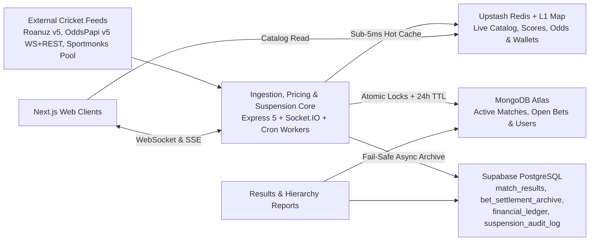
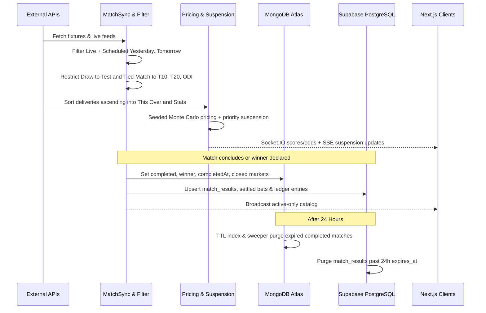

<div align="center">

# BetPro Exchange — Backend Engine & Polyglot Data Platform

**Low-Latency Sports Exchange Core, Real-Time Cricket Pricing Engine & Multi-Database Architecture**

[](https://nodejs.org/)
[](https://expressjs.com/)
[](https://www.mongodb.com/)
[](https://supabase.com/)
[](https://upstash.com/)
[](https://socket.io/)
[]()

</div>

---

## Overview

**BetPro Exchange Server** is the real-time core engine powering BetPro Exchange. Built with **Node.js**, **Express 5**, and **Socket.IO**, it orchestrates multi-provider cricket feed ingestion (**Roanuz Cricket API v5**, **OddsPapi v5 REST & WebSocket**, and a circuit-broken **Sportmonks Multi-Key Pool**), prices derivative markets via a deterministic **Monte Carlo simulation engine**, enforces sub-second **market suspension state machines**, executes atomic bet matching and liability locks, and distributes cascading profit/loss across a 4-tier agent hierarchy.

To combine sub-5ms feed responsiveness, atomic wagering locks, and bounded long-term storage, persistence is specialized across **three complementary data tiers**: **Upstash Redis**, **MongoDB Atlas**, and **Supabase PostgreSQL**.

---

## Technology Stack

<p align="left">
  
</p>

| Domain | Technology | Version | Role in Architecture |
|---|---|---|---|
| **Runtime & HTTP** | Node.js + Express + Compression + CORS | `20+` / `5.2.1` | Core API server, gzip compression & Vercel serverless adapter |
| **In-Memory & Distributed Cache** | Upstash Redis (`ioredis` TCP + `@upstash/redis` REST + L1 Map) | `6.1.0` / `1.41.0` | Sub-5ms live scores, quotes, wallets & pre-warmed match catalogs |
| **Operational Sportsbook DB** | MongoDB Atlas (Mongoose) | `9.4.1` | Active matches, nested markets, atomic `{ $gte }` wallet locks & 24h TTL |
| **Relational Archive & Ledger** | Supabase PostgreSQL (`@supabase/supabase-js` + `jose` JWKS) | `2.119.2` / `6.2.18` | 24h match result archive, settled bet archive, ACID ledger & suspension audits |
| **Real-Time Transport** | Socket.IO + `ws` + Express SSE | `4.8.3` / `8.20.0` | WebSocket client fan-out, OddsPapi WS ingestion & suspension SSE streams |
| **Scheduling & Feeds** | `node-cron` + Axios | `4.2.1` / `1.15.0` | Automated fixture sync, score polling, status lifecycle & settlement jobs |
| **Auth & Security** | `jsonwebtoken` + `bcryptjs` + `jose` | `9.0.3` / `3.0.3` | Role-scoped bearer JWTs, salted password hashes & Supabase JWKS verify |
| **Validation & Testing** | Native Node Test Runner (`node:test`) | Built-in | 143 automated tests across pricing, suspension, failover, feeds & DBs |

---

## System Design & Architecture

### 1. Polyglot Persistence & Real-Time Pipeline



### 2. Database Specialization Matrix

| Tier | Workload Assigned | Why This Engine | Eviction / Retention Lifecycle |
|---|---|---|---|
| **Tier 1: Upstash Redis (`ioredis` TCP + REST + L1 Map)** | `bpx:matches:live`, `bpx:matches:all`, `bpx:score:*`, `bpx:odds:*`, `bpx:user:*:wallet` | Sub-millisecond L1 hits & <5ms Redis TCP reads shield persistent databases from polling spikes | Short TTL (`2s–30s`) kept hot by `matchCatalogService` (`3s` live / `9s` catalog warmer) |
| **Tier 2: MongoDB Atlas (Mongoose)** | Active `Match` documents (nested `fancyMarkets`, `figureMarkets`, `evenOddMarkets`, `tiedMatchMarket`), active `Bet`, `User`, `MarketOdds`, `UserProfitLimit` | Single-document atomic `{ walletBalance: { $gte: liability } } + $inc` eliminates distributed lock overhead; dynamic nested market schemas update in place | Native TTL index `{ completedAt: 1 }` (`86400s` / 24h); upcoming matches outside `[yesterday .. tomorrow]` automatically pruned |
| **Tier 3: Supabase PostgreSQL (`supabaseService.js`)** | `match_results`, `bet_settlement_archive`, `financial_ledger`, `suspension_audit_log` | Typed relational integrity, indexed SQL aggregations, and offloading high-volume historical logs/audits from MongoDB Atlas storage quotas | `match_results` tracks `expires_at = completed_at + 24h` purged by SQL `purge_expired_match_results()` (`pg_cron` + backend sweeper); RLS enabled (`service_role` only) |

### 3. Background Worker Orchestration

| Scheduler / Engine | Cadence | Responsibility |
|---|---|---|
| `roanuzScoreService` (`liveScoreJob`) | `1.5s` active / `6s` idle | Primary Roanuz v5 live score, chronological ball-by-ball (`This Over`), batsmen/bowler & pre-match toss detector |
| `matchCatalogService` | `3s` live / `9s` full | Pre-warms slim active catalog (`-fancyMarkets -figureMarkets ...`) into L1 Map + Redis |
| `suspensionEngine` | Event-driven + `1s` tick | Evaluates staleness, wicket holds, end-of-over locks & liability bounds; pushes SSE & archives audits to Supabase |
| `oddsApiLiveService` | WebSocket + REST bootstrap | Sub-second Betfair Exchange & Bookmaker Back/Lay odds sync + unmatched bet auto-matching |
| `scoreService` (`scoreUpdate.job`) | `10s` fallback | OddsPapi score fallback strictly guarded against overwriting Roanuz or fresh Sportmonks matches |
| `statusService` (`statusUpdate.job`) | `60s` | `upcoming -> live -> completed` cricket transitions & immediate post-match settlement trigger |
| `resultSettlementService` (`settlementJob`) | `60s` | Official result verification, match completion stamping (`completedAt`), Supabase archival & active-only broadcast |
| `matchService` (`matchFetch.job`) | Startup + `15m` | Yesterday-to-tomorrow fixture sync, SRL removal, out-of-window pruning & 24h completed match cleanup |

### 4. End-to-End Match, Pricing & Settlement Flow



---

## Core Engines & Business Rules

- **Authoritative Ball-by-Ball Normalization (`services/roanuzScoreService.js`)**
  - Aligns Roanuz `ballByBall` responses with `live.innings` and `live.score.overs`, sorts reverse-chronological deliveries ascending (`compareRoanuzBalls`), selects the final delivery for `lastBall`, formats complex deliveries (`Wd`, `2Wd`, `Wd+W`, `Nb+W`, `4Lb`, `2B`, `W`), and eliminates synthetic fallback arrays (`[]` until actual deliveries occur).

- **Quantitative Pricing & Suspension (`services/pricing/`, `services/suspension/`)**
  - Seeded Monte Carlo simulator (p95 recompute benchmark `<150ms` for 20,000 simulations) prices Fancy, Last Figure (`0–9`), and Even/Odd lines deterministically from `(matchState, stateSeq)`.
  - Stateful priority suspension machine guards against stale feeds (`45s` tolerance), wicket settling holds, over boundaries, and exposure caps.

- **4-Tier Hierarchy P/L & SuperAdmin Wallet Governance (`services/hierarchyService.js`, `utils/superAdminWallet.js`)**
  - Cascades house profit/loss across `User -> Master -> SuperMaster -> Admin -> SuperAdmin -> Platform Book`, deducting the `1.5%` platform fee strictly on net house profit (`amount > 0`).
  - Enforces fixed `100,000` display wallet balance for `superadmin` accounts with unlimited administrative allocation (`admin`, `supermaster`, `master`, and `user` accounts remain strictly guarded by atomic `{ $gte }` balance deductions).

---

## Directory Structure

```text
betproexchange-server/
├── server.js                          # Express app, Socket.IO server, DB connect & health routes
├── api/index.js                       # Serverless export adapter
├── models/                            # Mongoose schemas (Match w/ 24h TTL, User, Bet, Transaction, etc.)
├── routes/                            # authRoutes, userRoutes, matchRoutes, adminRoutes, teenPattiRoutes
├── middleware/                        # JWT authentication & hierarchical authorization middleware
├── services/                          # Real-time pricing, feed ingestion & persistence services
│   ├── pricing/                       # Monte Carlo calibration, simulator & performance benchmarks
│   ├── suspension/                    # Stateful suspension machine & replay test suite
│   ├── supabaseService.js             # Supabase SDK client, JWKS verification & dual-write archive
│   ├── upstashRedisCache.js           # Dual TCP/REST Redis + L1 in-memory cache layer
│   ├── fixtureFilter.js               # Yesterday..tomorrow window, format & league eligibility
│   ├── matchCatalogService.js         # Slim projection, background warmer & active broadcaster
│   ├── matchService.js                # Schedule sync & 24h completed cleanup sweeper
│   ├── roanuzClient.js / roanuzScoreService.js
│   ├── sportmonksPoolClient.js / sportmonksScoreService.js
│   ├── oddsApiLiveService.js / oddsApiRest.js / scoreService.js
│   ├── fancyMarketsService.js / tossOddsEngine.js / cricketEngine.js
│   ├── statusService.js / resultSettlementService.js / settlementService.js
│   ├── hierarchyService.js / hierarchyHelper.js / limitService.js / openBetMatcher.js
├── jobs/                              # Node-cron background loops
├── supabase/migrations/               # PostgreSQL tables, indexes, RLS policies, grants & pg_cron
│   └── 001_betpro_dual_db.sql
├── utils/                             # Bet math & SuperAdmin wallet helpers
├── scripts/                           # Admin seeding & maintenance utilities
└── test/                              # 143 unit & integration tests (Node native test runner)
```

---

## Getting Started

### Prerequisites

- **Node.js** `>= 20.0.0`
- **MongoDB Atlas** (or local MongoDB server)
- **Supabase PostgreSQL** project (optional until schema migration is applied; writes degrade gracefully without interrupting MongoDB flows)
- **Upstash Redis** instance (optional; falls back transparently to L1 memory cache)

### Environment Variables

Copy `.env.example` to `.env` and populate values privately (never commit `.env`):

```env
PORT=5000
APP_TIMEZONE_OFFSET_MINUTES=300

# Databases & Cache
MONGO_URI=mongodb+srv://<username>:<password>@<cluster>.mongodb.net/betpro?retryWrites=true&w=majority
REDIS_URL=rediss://default:<password>@<host>:<port>
UPSTASH_REDIS_REST_URL=https://<instance>.upstash.io
UPSTASH_REDIS_REST_TOKEN=<your_upstash_rest_token>

# Supabase PostgreSQL (Relational Archive, Ledger & JWKS)
SUPABASE_URL=https://<project-ref>.supabase.co
SUPABASE_PUBLISHABLE_KEY=<your_supabase_publishable_key>
SUPABASE_SECRET_KEY=<your_supabase_secret_key>
SUPABASE_JWKS_URL=https://<project-ref>.supabase.co/auth/v1/.well-known/jwks.json

# Auth & External Sports Feeds
JWT_SECRET=<strong_random_jwt_secret>
ODDS_API_KEY=<your_oddspapi_key>
SPORTMONKS_API_KEY=<your_sportmonks_key>
ROANUZ_PROJECT_KEY=<your_roanuz_project_key>
ROANUZ_API_KEY=<your_roanuz_api_key>
```

### Setup & Verification

```bash
# 1. Install dependencies
npm install

# 2. Apply Supabase SQL migration once in Supabase Dashboard -> SQL Editor:
#    supabase/migrations/001_betpro_dual_db.sql

# 3. Start backend & WebSocket server
npm start

# 4. Run full verification suite (143 tests)
npm test
```

---

## API Reference Summary

| Endpoint | Access | Responsibility |
|---|---|---|
| `GET /health` \| `GET /api/health` | Public | Server uptime, MongoDB state & Supabase schema diagnostics |
| `GET /api/pool-status` | Public | Sportmonks pool failover metrics, Redis stats & Supabase status |
| `GET /api/matches/live` | Public | Slim pre-warmed active live cricket fixtures |
| `GET /api/matches` | Public | Live-first active fixture catalog (`yesterday .. tomorrow`) |
| `GET /api/matches/results` | Public | Recently concluded results within the 24-hour retention window |
| `GET /api/matches/:id` | Public | Detailed markets & scorecards (MongoDB / Redis / Supabase fallback) |
| `GET /api/matches/:matchId/suspension-stream` | Public | Server-Sent Events stream for real-time market halts |
| `POST /api/auth/login` \| `/api/auth/register` | Public | JWT issuance & role authentication |
| `GET /api/user/wallet` | Auth | Wallet, credit & normalized SuperAdmin balance lookup |
| `POST /api/user/bet` | Auth | Atomic balance deduction, odds/suspension validation & placement |
| `POST /api/user/bets/:betId/cancel` | Auth | Unmatched open-bet cancellation & liability refund |
| `POST /api/admin/*` | Role Guarded | Hierarchy provisioning, cash settlement, profit limits & winner declarations |

---

## Security Architecture

- **Zero Secrets in Source Control**: `.env` is excluded via `.gitignore`; `SUPABASE_SECRET_KEY` operates strictly on the server with PostgreSQL Row Level Security enforcing `service_role` access only.
- **Atomic Financial Guards**: Bet placements and hierarchy balance transfers require atomic MongoDB `{ $gte }` preconditions (`findOneAndUpdate`) preventing race conditions and negative-balance exploits.
- **Strict Role & Input Enforcement**: Routes enforce JWT signatures, hierarchical ancestor ownership, per-market profit/stake caps, and exclusion of client-originated odds tampering.

---

## License

Proprietary and Confidential. Unauthorized copying, distribution, or modification without explicit written authorization is strictly prohibited.
